
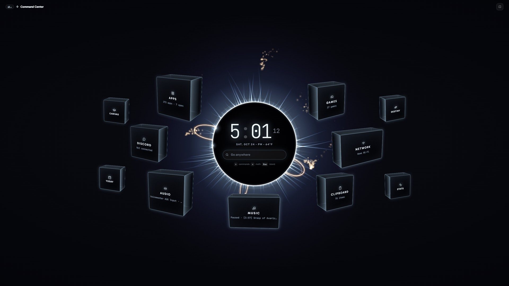

<h1 align="center">Island Shell</h1>

<b>Your Windows taskbar, reimagined as a glowing island.</b> 
Music with lyrics, Discord calls, sound, your day, your games and your whole PC, one tap of the Windows key away.

  <a href="https://github.com/AbyssLotus/island-shell/releases/latest/download/IslandShellSetup.exe"><b>⬇ Download for Windows</b></a>
  &nbsp;·&nbsp; <a href="docs/SETUP.md">Setup guide</a>
  &nbsp;·&nbsp; <a href="docs/FEATURES.md">Everything it does</a>

Windows 10 / 11 (64-bit) · one-click install · no admin rights

---

## What it is

Island Shell replaces the Windows taskbar with a pill at the top of your screen that grows into whatever you need: what's playing, who's talking in your Discord call, volume and devices, your calendar and due dates, your Steam library, open windows, the clipboard, and live stats. **Win + Space** opens the **Command Center**, a full-screen eclipse with one search for everything and every section as a cube. Its look is "Taken": cold light leaking out of black.

<table>
<tr>
<td width="50%">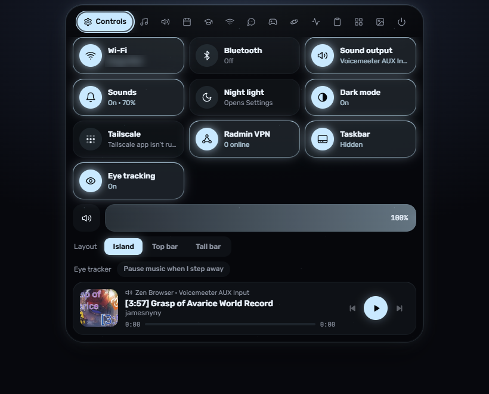</td>
<td width="50%">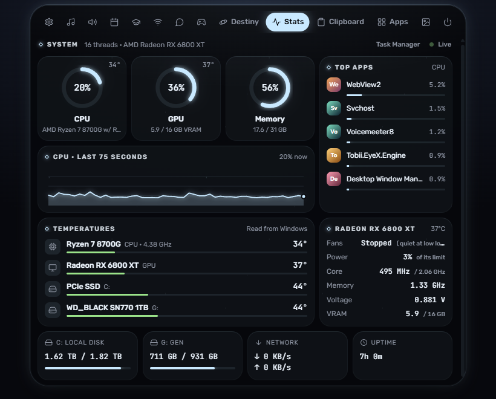</td>
</tr>
<tr><td align="center">Controls, with what's playing</td><td align="center">Stats and temperatures, no extra tools needed</td></tr>
</table>

## Highlights

- **The island.** Tap the Windows key to open it, hover to peek. Controls, Music (with time-synced lyrics), Audio (devices, per-app volume, Voicemeeter), Today (calendar, weather, to-dos), Canvas, Network, Discord, Games, Destiny, Stats, Clipboard, Apps, Wallpaper and Power. Prefer a classic bar? Switch to a full-width top bar.
- **The Command Center.** One search for apps, windows, files, folders, games, settings and commands (`>` for commands, `=` for math). Each cube opens its section full size.
- **Your Steam library, full size.** Hero art and logos (your custom ones first), playtime, Play / Update, and your other launchers.
- **Every app.** Pinned, opened lately, folders and A to Z, with run as administrator, file location and uninstall.
- **A real Task Manager.** Summary, Performance (every logical processor), Processes, System Info, App history, Startup apps, Users, Services, Power & Freq (sensors and your SSDs' health), Connections, Installed Apps, Disk Space and Benchmarks.
- **Works with your stuff.** Apple Music and Spotify, Discord, Steam, Canvas, Destiny 2, Google / Outlook / iCloud calendars, Voicemeeter, Wallpaper Engine, Tailscale, Tobii eye tracking.
- **Light on your PC.** About 100 MB of memory at rest; heavy views and docked sites are let go of when you leave them.

<table>
<tr><td colspan="2">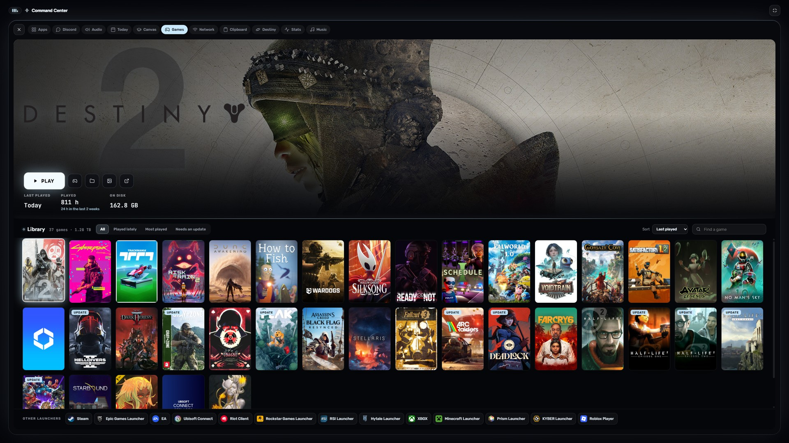</td></tr>
<tr><td colspan="2" align="center">The Games cube</td></tr>
<tr>
<td width="50%">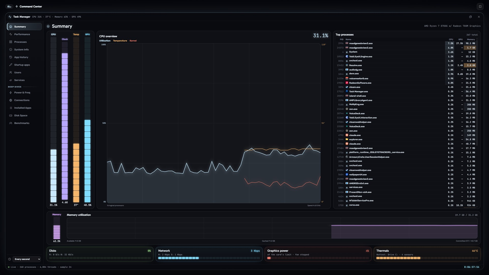</td>
<td width="50%">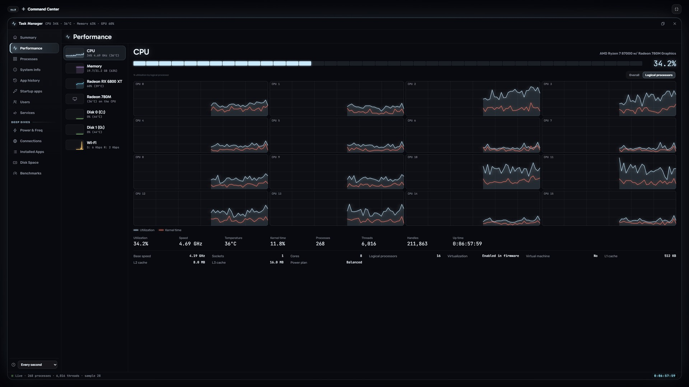</td>
</tr>
<tr><td align="center">Task Manager: Summary</td><td align="center">Performance, per logical processor</td></tr>
<tr>
<td width="50%">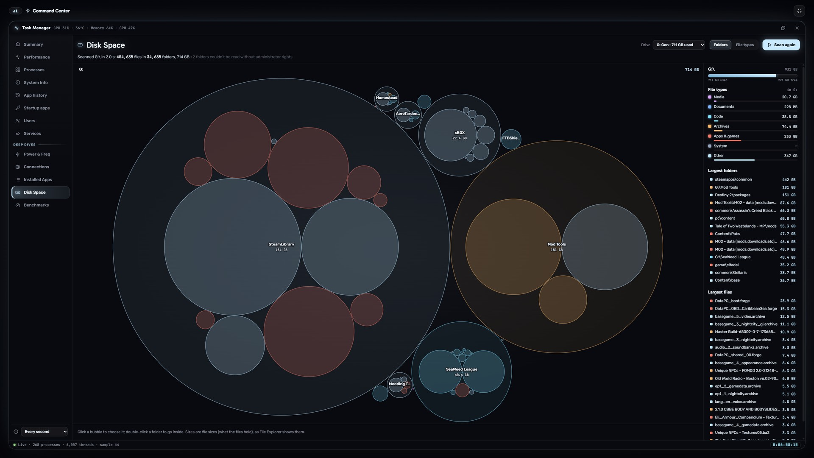</td>
<td width="50%">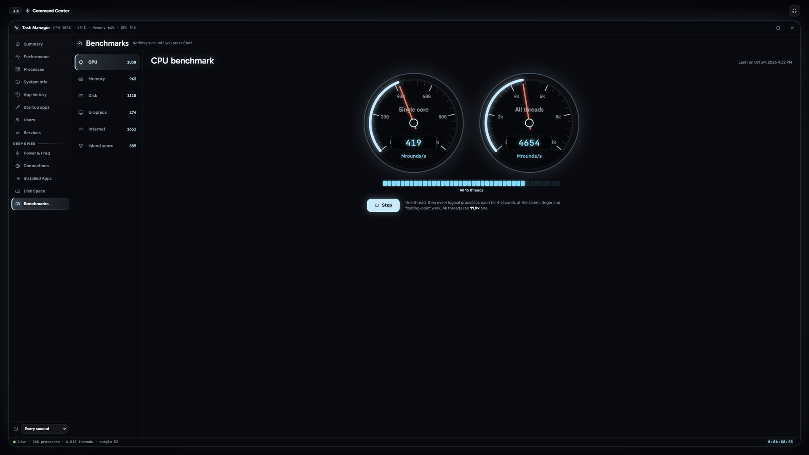</td>
</tr>
<tr><td align="center">Disk Space</td><td align="center">Benchmarks</td></tr>
<tr>
<td width="50%">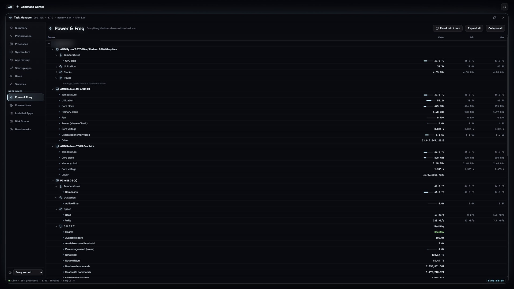</td>
<td width="50%">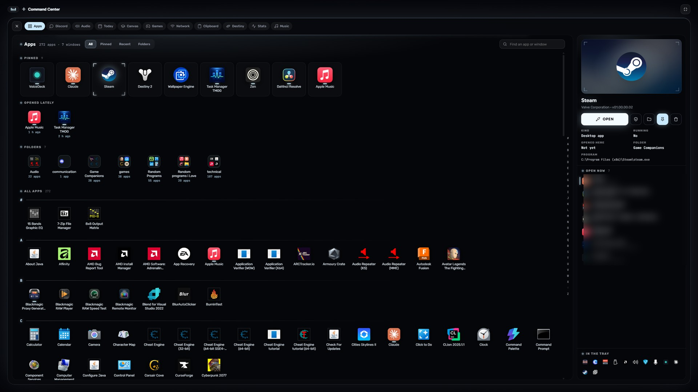</td>
</tr>
<tr><td align="center">Power &amp; Freq, with SSD health</td><td align="center">The Apps cube</td></tr>
</table>

## Install

1. Download **[IslandShellSetup.exe](https://github.com/AbyssLotus/island-shell/releases/latest/download/IslandShellSetup.exe)**.
2. Run it. It installs in a few seconds, for your account only, and the island appears. If Windows says *"Windows protected your PC"* (Island Shell isn't code-signed yet), click **More info → Run anyway**.
3. The setup guide walks you through the rest in about a minute.

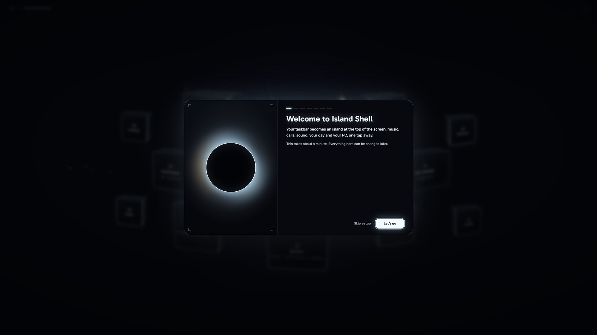

The **[setup guide](docs/SETUP.md)** has every step, plus how to connect Discord, Canvas, Destiny 2 and calendars.

**Uninstall** from Settings → Apps → Installed apps. Your taskbar comes back as it was. (If it ever stays hidden, run **Restore the taskbar (Island Shell)** from the Start menu.)

## Privacy

There are no accounts, no telemetry and no servers of its own. Everything stays on your PC. Keys and tokens you enter (Discord, Canvas, Bungie, calendar links) are encrypted for your Windows account. Island Shell only talks to:

| What | Why |
| --- | --- |
| [Open-Meteo](https://open-meteo.com) | Weather for the city you choose |
| [LRCLIB](https://lrclib.net) | Lyrics for what's playing (title, artist, album, length) |
| Apple's iTunes Search | Album art, year and genre for the Music sheet (title, artist, album) |
| Discord | Your Discord app on this PC, and Discord's sign-in for the application you create |
| Your school's Canvas, Bungie, your calendars | Only if you connect them, with the details you enter |
| [speed.cloudflare.com](https://speed.cloudflare.com) | Only when you run the internet benchmark |
| Google Fonts | The island's typefaces |

The docked websites in the Command Center (Discord, DIM, your Canvas) are those websites, opened like a browser would.

## Build it yourself

See **[docs/BUILDING.md](docs/BUILDING.md)**: Rust, the Tauri CLI, and `cargo tauri build` for the installer.

## Notes

- Island Shell isn't affiliated with Apple, Discord, Valve, Bungie, Instructure or Microsoft. Game artwork comes from your own Steam library.
- The look is inspired by the Taken of Destiny 2; its sigil and art are original.
- The Audio section's Voicemeeter engine comes from the VoiceDeck project (MIT).
