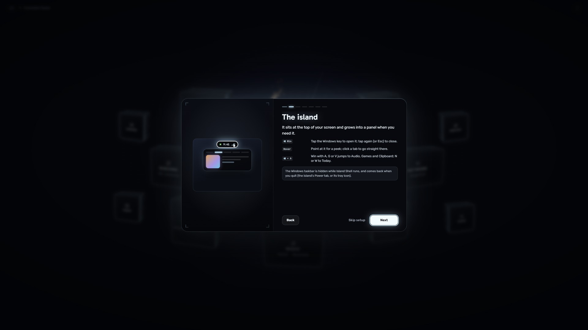
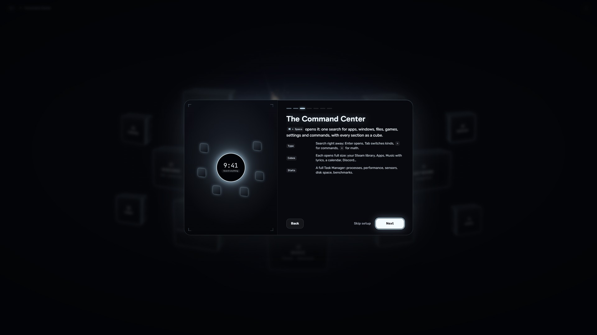
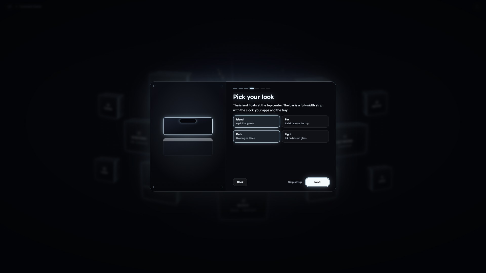
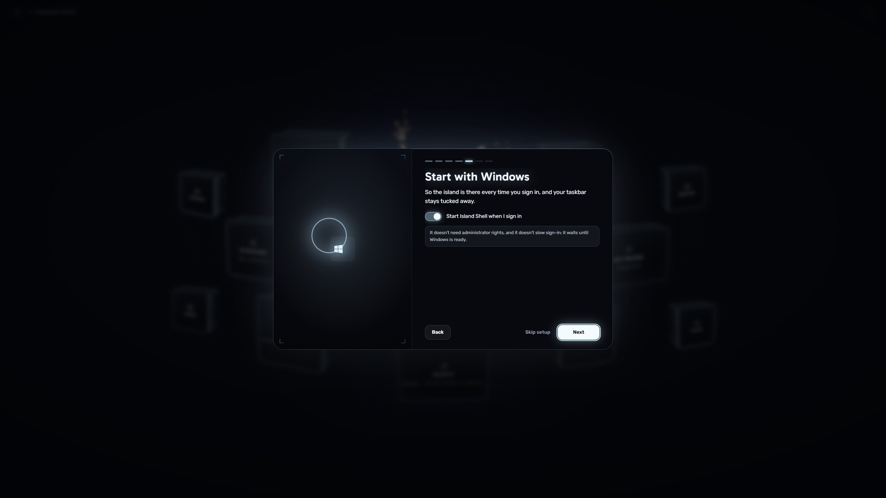
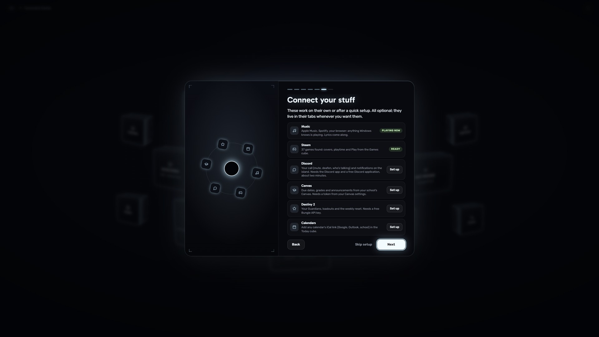
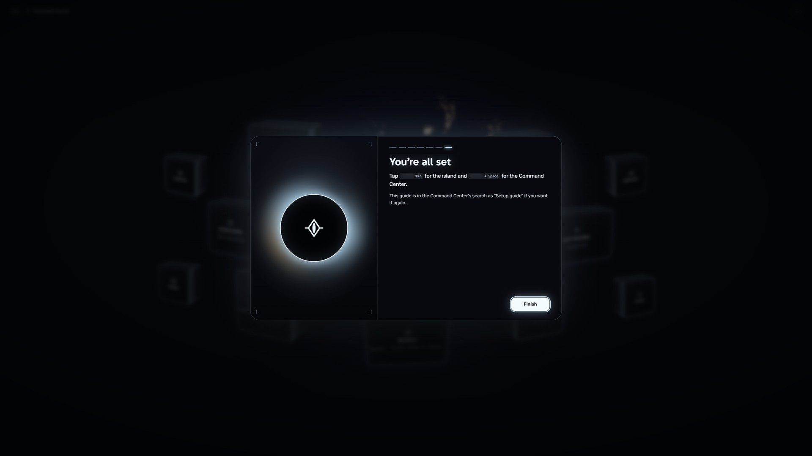

# Setting up Island Shell

From download to a working island in about two minutes. Everything after step 3 is optional.

> [!NOTE]
> Island Shell is in active development, so you may run into bugs. [Troubleshooting](#troubleshooting) covers the common ones, and [issues](https://github.com/AbyssLotus/island-shell/issues) are welcome.

- [1. Download it](#1-download-it)
- [2. Install it](#2-install-it)
- [3. The setup guide](#3-the-setup-guide)
- [4. Everyday use](#4-everyday-use)
- [5. Modules: add what you want](#5-modules-add-what-you-want)
- [6. Change the look](#6-change-the-look)
- [Troubleshooting](#troubleshooting)
- [Uninstalling](#uninstalling)

## 1. Download it

Get **[IslandShellSetup.exe](https://github.com/AbyssLotus/island-shell/releases/latest/download/IslandShellSetup.exe)** from the [latest release](https://github.com/AbyssLotus/island-shell/releases/latest).

You need Windows 10 or 11, 64-bit. It's about 3 MB.

## 2. Install it

Double-click **IslandShellSetup.exe**. There are no pages to click through: a small window shows the progress for a few seconds, then the island appears at the top of your screen.

- **"Windows protected your PC"**: Island Shell isn't code-signed yet, so SmartScreen may stop it the first time. Click **More info**, then **Run anyway**.
- **No administrator rights needed.** It installs for your account only, in `%LOCALAPPDATA%\Island Shell`, with a Start menu shortcut and a desktop shortcut.
- **Prefer to pick the folder?** Run `IslandShellSetup.exe /WIZARD` for the usual installer pages.
- **Updating** is the same: run the newer installer. It closes the running island properly first and keeps your settings.

## 3. The setup guide

The first time Island Shell starts, it opens the setup guide. It takes about a minute, and every step can be skipped.

| | |
| --- | --- |
|  | **Welcome.** What the island is. Press **Let's go**, or **Skip setup** to start straight away. |
|  | **The island.** Tap the **Windows key** to open it, hover for a peek, Win + A / G / V / N to jump to a section. Your taskbar is hidden while Island Shell runs and comes back when you quit. |
|  | **The Command Center.** **Win + Space** opens a full-screen search for apps, windows, files, games, settings and commands, with every section as a cube. |
|  | **Pick your look.** The **Island** (a pill that grows) or the **Bar** (a strip across the top), dark or light. |
|  | **Start with Windows.** On by default, so the island is there every time you sign in. |
|  | **Pick your modules.** Everything beyond the island, the Command Center, the Task Manager and your calendar is a module: Music, Discord, Canvas, Destiny 2, Steam & games, Voicemeeter, Wallpaper Engine, VPN and the Tobii eye tracker. **Add** the ones you want (Music is ticked to start with). They install in the background while you finish; the ones that need a key have a **Set up** button (see [step 5](#5-modules-add-what-you-want)). |
|  | **Done.** You can open the guide again any time: search **Setup guide** in the Command Center. |

## 4. Everyday use

| To | Do |
| --- | --- |
| Open the island | Tap the **Windows key**, click the pill, or scroll down on it |
| Peek at what's playing | Hover the pill |
| Close it | **Esc**, click outside it, or tap the Windows key again |
| Switch sections | ← / →, the number keys, or click the icons along the top |
| Open the Command Center | **Win + Space** |
| Jump to a section | **Win + A** (Audio), **G** (Games), **V** (Clipboard), **N** or **W** (Today) |
| Open the Start menu | **Ctrl + Esc** (the Windows key opens the island now) |
| Quit | The island's **Power** section, or the tray icon |

The Command Center's cubes open each section full size: every app, a calendar, the **Stats** cube's full Task Manager (processes, performance, sensors, disk space, benchmarks and more), the **Modules** cube, and a cube for each module you've added (your Steam library, music with lyrics, Discord…).

## 5. Modules: add what you want

Island Shell itself is the island, the Command Center, the Task Manager and stats, the calendar, apps, the clipboard, sound and network. Everything else is a **module** you add only if you want it; a module you leave out isn't on your PC at all.

- **Add or remove one** in the Command Center's **Modules** cube: **Available** lists what you can add, **Installed** what you have. Each shows what it does, what it talks to, and (while it runs) the memory and CPU it uses. **Turn off** keeps it but stops it; **Remove** deletes it, with or without its keys and data.
- **Or search for it**: type its name (or what it does, like *lyrics*) in the Command Center and pick **Install …**.
- **Updates** come by themselves while **Check daily** is on (the island's **Power** section), or from the Modules cube.
- Modules come from Island Shell's own releases on GitHub, signed, and are checked before anything is unpacked. Keys and tokens you enter are stored encrypted for your Windows account, and stay on your PC.

### Music
Nothing to set up. Apple Music, Spotify, your browser and anything else that shows in Windows' media controls appear on the island, with time-synced lyrics from [LRCLIB](https://lrclib.net) when there are some. Apple Music gets extras (album, seek, shuffle, repeat, favorite). Without it, the resting island shows the weather, the date and the clock.

### Steam & games
Nothing to set up. Installed games show up in the Games section and cube with your custom artwork, playtime and a Play button. Other launchers (Epic, EA, Ubisoft, Riot, Battle.net…) sit underneath. **Win + G** opens it.

### Discord
Your call (who's talking, mute, deafen, leave) and your @mentions on the island, and Discord docked in the Command Center. Discord needs a small "application" of your own, which takes about two minutes:

1. Open the [Discord Developer Portal](https://discord.com/developers/applications) and click **New Application**. Name it **Apple Music** if you'd like your status to read "Listening to Apple Music".
2. On the app's **OAuth2** page, add the redirect `http://localhost` and save.
3. Copy the **Client ID** and **Client Secret** from that page into the island's **Discord** section and press **Connect**.
4. Discord (the desktop app, which must be running) asks you to authorize it. Click **Authorize**.

### Canvas
Due dates, grades and announcements from your school's Canvas, in the **Canvas** section and the calendar. Two ways:

- **Calendar feed** (no token): in Canvas, open **Calendar**, click **Calendar Feed** (bottom right), copy the link that ends in `.ics` and paste it in. You get due dates and course events.
- **Access token** (everything): in Canvas, open **Account → Settings**, click **+ New Access Token**, name it "Island Shell", copy the token and paste it in with your school's Canvas address (like `school.instructure.com`).

### Destiny 2
Your Guardians, loadouts, Xûr and the weekly reset, and DIM docked in the Command Center (DIM needs no key).

1. On [bungie.net/en/Application](https://www.bungie.net/en/Application), click **Create New App**. Any name works; set **OAuth Client Type** to **Not Applicable**.
2. Copy the app's **API Key** into the island's **Destiny** section, with your Bungie Name (like `Guardian#1234`).

### Voicemeeter, Wallpaper Engine, VPN
Nothing to set up: Voicemeeter's mixer appears in **Audio** (with a mic switch on the top bar), your Wallpaper Engine library in **Wallpaper**, and Tailscale and Radmin VPN in **Network**.

### Tobii eye tracker
With a Tobii tracker, the island opens when you look at it, and notifications wait until you've seen them. Turn on **Pause when I step away** in the Music tab (or the Music module's settings) to pause what's playing while you're away.

### Calendars (built in)
In the Command Center's **Today** cube, add any calendar's iCal link: Google Calendar (Settings → your calendar → *Secret address in iCal format*), Outlook (Settings → Calendar → Shared calendars → *Publish a calendar*), iCloud, or your school's.

### Upgrading from 0.1
Version 0.1 had everything built in. The first time 0.2 starts, it adds back the modules you were using (Music, plus the ones you'd set up or whose apps are on your PC), in the background, keeping your keys and settings. The Modules cube shows them coming in.

## 6. Change the look

- **Layout**: Controls → **Layout**: Island, Top bar or Tall bar. Island Shell restarts in the new layout in about a second.
- **Dark or light**: Controls → **Dark mode**.
- **Accent and wallpapers**: the **Wallpaper** section has procedural wallpapers that set the accent color, and your Wallpaper Engine library.

## Troubleshooting

- **The taskbar didn't come back.** Open the Start menu (Ctrl + Esc) and run **Restore the taskbar (Island Shell)**. Starting Island Shell and quitting it again does the same.
- **The Windows key opens the Start menu instead of the island.** Island Shell isn't running, or another keyboard tool has the key. Start it from the Start menu.
- **Discord says it can't connect.** The Discord desktop app has to be running (not just the website), and the redirect `http://localhost` has to be saved on your app's OAuth2 page.
- **A game or app is missing.** Steam games appear once Steam has installed them; apps come from the Start menu's All apps list.
- **A module didn't install.** Modules download from GitHub; without a connection they wait and try again at the next start. The Modules cube shows what's waiting, and each module's recent log.
- **Something else.** Island Shell writes a log to `%APPDATA%\league.seaweed.islandshell\island.log`. [Open an issue](https://github.com/AbyssLotus/island-shell/issues) with what happened and the end of that log.

## Uninstalling

**Settings → Apps → Installed apps → Island Shell → Uninstall.** The uninstaller closes the island properly first, so your taskbar comes back as it was. To also remove your settings, modules and caches, tick **Delete the application data** on the uninstaller's page, or delete `%APPDATA%\league.seaweed.islandshell` and `%LOCALAPPDATA%\league.seaweed.islandshell` afterwards.
