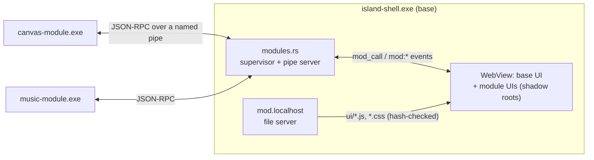

# Modules: design draft

> **Status: draft, not implemented** (2026-10-24, aimed at v0.2). Nothing here exists in the code yet.
> The step-by-step build plan, with formats and definitions of done, is in [modules-handoff.md](modules-handoff.md).

## Goal

The base app installs with the island, the Command Center, the Task Manager and stats, and the calendar. Every third-party integration, such as eye tracking, Canvas, Destiny 2 or Music, is a **module** that the user installs only if they want it.

"Not installed" has to mean it's really gone:

- No files on disk.
- No process running.
- No tab, cube, hotkey or search results.
- No network traffic.
- No settings.

Installing a module adds all of that **without restarting the island**. Removing it takes it all away again, and keys and data are kept unless the user asks to forget them.

## What's base and what's a module

**Base** is everything that is Windows itself, or Island Shell's own:

| Area | Code today |
| --- | --- |
| Island, bar, taskbar, Windows key, tray | `island.rs`, `taskbar.rs`, `winkey.rs`, `tray.rs` |
| Command Center and search | `cc.js`, `apps.rs`, `running.rs`, `places.rs` |
| Task Manager (all 13 pages) and stats | `taskmgr.rs`, `sysinfo.rs`, `services.rs`, `installed.rs`, `conns.rs`, `diskscan.rs`, `bench.rs`, `sensors.rs`, `stats.rs` |
| Calendar, iCal feeds, weather, to-dos (Today) | `calendar.rs`, `ics.rs`, `cc-calendar.js` |
| Apps, Clipboard, Power, procedural wallpapers | `cc-apps.js`, `clipboard.rs`, … |
| Audio devices and per-app volume, Wi-Fi, Bluetooth | `audio.rs`, `radios.rs` |
| Setup guide | `setup.js` |
| **Docking engine** (a service modules use) | `embed.rs` |

**Modules** (about 5,400 lines of Rust today, plus their UI):

| Module | Backend today | UI it brings | Talks to | Runs |
| --- | --- | --- | --- | --- |
| **Music** | `media.rs`, `applemusic.rs`, `lyrics.rs`, `music.rs` | Music tab, Music cube (`cc-music.js`), now playing on the island and in Controls | LRCLIB, iTunes Search | Always |
| **Discord** | `discord.rs` | Discord tab, docked Discord with `discord-skin.css`, call activity, notifications | Discord app (local pipe), discord.com | While Discord runs |
| **Canvas** | `canvas.rs` | Canvas tab, docked Canvas with `canvas-skin.css`, due dates in the calendar | Your school's Canvas | On a schedule |
| **Destiny 2** (with DIM) | `destiny.rs` | Destiny tab, docked DIM with `dim-skin.css`, weekly reset in the calendar | bungie.net | On demand |
| **Tobii eye tracker** | `gaze.rs` | Presence ("looking at the island", "stepped away"), its settings | Nothing; uses the Tobii runtime on this PC | Always, while on |
| **Steam & games** | `games.rs` | Games tab, Games cube (`cc-games.js`), Win + G | Steam's files on disk | On demand |
| **Voicemeeter** | `voicemeeter.rs`, `crates/vd-vm-core` | The mixer section of Audio, VoiceDeck launcher | Voicemeeter on this PC | While Audio is open |
| **Wallpaper Engine** | `wpe.rs` | The library section of Wallpaper | Nothing | On demand |
| **VPN** | `vpn.rs` | Tailscale and Radmin in Network | Those apps on this PC | While Network is open |

Without Music, the island's resting pill shows the clock, the date, the temperature and a weather icon (sunny, cloudy, rainy or snow). Controls drops its now-playing card.

## Architecture: separate processes, plus UI bundles

Each module is a folder with three parts:

- A **manifest**.
- An optional **backend exe**. It runs as its own small process, which the island starts and stops.
- A **UI bundle** (JS and CSS) that the island loads into its own page.



### Why separate processes

- **Taskbar safety.** The base hides the Windows taskbar, so it must never crash. A misbehaving integration must not be able to take it down: a bad Tobii DLL, UI Automation reaching into Apple Music, or a surprise from the Bungie API. A module crash costs that module, nothing else.
- **Memory.** A module that isn't installed or isn't running costs 0 MB. That fits the 200 MB goal; today every integration's thread runs whether you use it or not.
- **Real installs.** Installing is unpacking a folder. Removing is deleting it. The base never has to be rebuilt.
- **Independent updates.** A Canvas fix ships without touching the island.
- **The cost:** about 1.5–3 MB of memory per running module, plus a pipe hop of well under a millisecond. Neither matters for anything here.

### Alternatives considered

| Option | Why not |
| --- | --- |
| Cargo features (variant builds) | Not something a user installs. It's a choice made at build time. |
| DLL plugins (`cdylib`) | Rust has no stable ABI, a module crash is a shell crash, and threads can't be unloaded safely. |
| WASM plugins | Sandboxed, but no Win32: no Tobii DLL, no UI Automation, no named pipes. |
| One exe with on/off toggles | Everything stays on disk. That isn't what was asked, but it is Phase 0's stepping stone. |

## The module package

```
%LOCALAPPDATA%\league.seaweed.islandshell\modules\
  installed.json             which modules, versions, enabled or not
  canvas\
    module.json
    canvas-module.exe
    ui\canvas.js  ui\canvas.css  ui\icon.svg
    skins\canvas-skin.css
  .staging\  .trash\         used by install and update
```

**Data** goes in `%APPDATA%\league.seaweed.islandshell\modules\<id>\`: settings, DPAPI-encrypted keys and caches.

- Code and data are kept apart so an update never touches your keys.
- Module code is not under the install folder, because base upgrades and uninstalls rewrite that folder.

```jsonc
// module.json
{
  "id": "canvas",
  "name": "Canvas",
  "version": "1.0.0",
  "api": 1,                                   // module API version it was built for
  "description": "Due dates, grades and announcements from your school's Canvas.",
  "icon": "ui/icon.svg",
  "backend": { "exe": "canvas-module.exe", "run": "scheduled", "every": "15m" },
  "ui": { "entry": "ui/canvas.js", "css": ["ui/canvas.css"] },
  "contributes": {
    "tabs":     [{ "id": "canvas", "title": "Canvas", "icon": "cap", "order": 60 }],
    "sites":    [{ "id": "canvas", "url": "{settings.baseUrl}", "skin": "skins/canvas-skin.css" }],
    "cubes":    [{ "id": "canvas", "site": "canvas" }],
    "calendar": [{ "source": "canvas", "name": "Canvas", "color": "#f5c26b" }],
    "hotkeys":  [],
    "setup":    { "card": true }
  },
  "talksTo": ["Your school's Canvas"],        // shown before install and in the privacy view
  "legacy": ["canvas.json"],                  // 0.1.x files it takes over (see Migration)
  "files": { "canvas-module.exe": "sha256-…", "ui/canvas.js": "sha256-…" }
}
```

## Backend: the module process

**Starting.** `modules.rs` (new, in the base) starts each module with `CREATE_NO_WINDOW`. Module exes are built with `windows_subsystem = "windows"`, so a console window never flashes. Every module process goes into one Job Object with `KILL_ON_JOB_CLOSE`, so if the island exits or crashes, its modules go with it and nothing is orphaned.

**Connecting.** The module gets these arguments: `--pipe \\.\pipe\island-shell-<session>-<id> --data <dir> --api 1`.

- The base creates the pipe. It uses a DACL for the current user only, plus `PIPE_REJECT_REMOTE_CLIENTS`.
- The base checks `GetNamedPipeClientProcessId` against the PID it spawned. Nothing else can pose as a module.

**Talking.** JSON-RPC 2.0, one message per line, in both directions.

| Base → module | |
| --- | --- |
| `init` | API version, data dir, settings, locale, theme, legacy file paths |
| `call` | A UI request forwarded from `mod_call(id, method, params)` |
| `tick` | A scheduled wake-up (Canvas polling); the module may exit after |
| `event` | Topics it subscribed to: `island.geometry`, `session.lock`, `power.resume`, `fullscreen`, `media.state`, `presence`… |
| `shutdown` | Stop. After 2 s the job kills it. |

| Module → base | |
| --- | --- |
| `emit` | Pushes to its own UI as the Tauri event `mod:<id>:<name>` |
| `notify` | An island notification (title, body, icon, action) |
| `activity` | Sets or clears a live activity on the pill: now playing, in a call |
| `calendar.put` | Replaces its events in its calendar source (cached, so the calendar works while it's stopped) |
| `publish` | Shared state on a topic other modules can subscribe to |
| `log` | Writes to `island.log` with the module's prefix |

**When modules run:**

| Mode | Behavior | Used by |
| --- | --- | --- |
| `always` | Runs the whole time | Music, Tobii |
| `while-process` | Runs while `Discord.exe` or `voicemeeter.exe` runs (the Task Manager snapshot already knows) | Discord, Voicemeeter |
| `scheduled` | Woken every N minutes, then exits | Canvas |
| `on-demand` | Starts on the first call and exits after 60 s idle, like the embed reaper | Destiny 2, Steam, Wallpaper Engine, VPN |

**Crashes.** The base restarts a crashed module after 1 s, then 5 s, then 30 s. After 3 crashes in 5 minutes it stays stopped. The Modules sheet then shows the module with **Restart** and its last log lines.

**SDK** (`crates/island-module`, new):

- The pipe client and the JSON-RPC loop.
- A `Module` trait: `init`, `call`, `event`, `tick`.
- Helpers for `emit`, `notify`, `activity`, `calendar_put` and `publish`.
- `secrets`: the DPAPI code, moved out of the base's `util`.
- An HTTP helper that refuses hosts the manifest doesn't declare. That's discipline, not a sandbox.
- A `--stdio` mode, so a module can be tested and debugged without the island running.

### Couplings in today's code, and what replaces them

| Today | With modules |
| --- | --- |
| `gaze.rs` reads `shared.media_playing` / `media_source` to pause music when you step away | Music publishes `media.state`, and Tobii publishes `presence`. Music subscribes to `presence` and pauses itself on `away`. Each still works alone. |
| `gaze.rs` reads the island's geometry, hwnd, monitor and fullscreen state | The base sends `island.geometry` and `fullscreen` events to subscribers. |
| `discord.rs` reads `status.media` | It subscribes to `media.state`, when Music is installed. |
| `calendar.rs` calls `canvas::overview` and `destiny::status` directly | The calendar gets a sources registry. Canvas and Destiny send `calendar.put`, and Destiny computes the reset itself. `calendar.json` keeps colors and on/off per source id. |
| `winkey.rs` hardcodes `G → games` in `SHORTCUTS` | The base keeps the keyboard hook. Manifests declare `hotkeys: [{ "key": "G", "opens": "tab:games" }]`, and the hook's key set is rebuilt when modules change. |
| `discord-skin.css`, `dim-skin.css` and `canvas-skin.css` live in the base | They move into their modules. `embed.rs` stays in the base and takes the skin from the manifest. |

## Front end: module UI

**Serving.** A new custom protocol, `mod` (`register_asynchronous_uri_scheme_protocol`), which WebView2 serves as `http://mod.localhost/<id>/<path>`. It serves only:

- Modules that are installed and enabled.
- Files the manifest lists, after their sha256 checks out (checked once per session).

It sends the right MIME types, plus `Access-Control-Allow-Origin` so `import()` works from the island's origin.

**CSP.** Add `http://mod.localhost` to `script-src`, `style-src` and `img-src`. `connect-src` stays as it is: module network traffic goes through its backend. That keeps the CSP tight and the privacy table honest.

**Loading.** A module's tab or cube appears straight away from its manifest. Its JS loads on first open with `import()` and must export `activate(ctx)` and `deactivate()`. Lazy loading keeps the base's startup and memory where they are.

**Isolation.** Each module mounts in a **Shadow DOM** root.

- The base adopts its UI-kit stylesheet (a constructable `CSSStyleSheet`) into every module root. Theme variables like `--glow` and the accent inherit through the boundary, so modules look like the island without copying its CSS.
- Neither side's classes can reach the other. This prevents the setup guide's `.ring`/`.pill`/`.win` collisions in both directions.

**This is not a security boundary.** Module JS runs in the island's page and could call any Tauri command. Trust comes from signatures (below), not from the sandbox.

**`ctx` (API v1):**

```js
ctx.call(method, params)           // its backend
ctx.on(event, fn)                  // its backend's emits
ctx.store.get(k, d) / .set(k, v)   // localStorage, namespaced mod.<id>.*
ctx.ui                             // kit helpers: icon(), toggle(), rows, sparkline, formatters
ctx.tabs.register({ id, mount(root), show(), hide() })
ctx.cubes.register({ id, sheet: { mount(root) } })   // or a site from the manifest
ctx.search.register({ kind, query(q) })              // Command Center results
ctx.commands.register({ id, title, run() })          // ">" commands
ctx.activity.set({ ... }) / ctx.notify({ ... })
ctx.settings.mount(root)           // its page in the Modules sheet
ctx.open('tab:canvas')             // navigation
```

**Base refactor this needs.** Today `index.html` has 14 hardcoded `data-tab`s, and `app.js` (2,756 lines) renders all of them. `cc.js` has fixed `CUBES`, `NATIVE` and `SITES`. They all become registries that the base's own sections use too, so the base is the API's first client.

## Installing, updating, removing

**The catalog.** Every GitHub release carries:

- The base installer.
- One zip per module.
- `modules.json`: id, name, version, api, size, sha256, URL, description, talks-to.
- `modules.json.sig`: an ed25519 signature in minisign format, the same format Tauri's updater uses.

The island reads `https://github.com/AbyssLotus/island-shell/releases/latest/download/modules.json`.

- **Why the same release:** the README's download button points at `releases/latest/download/IslandShellSetup.exe`. A separate module release would become "latest" and break that link. Unchanged modules are re-attached to each release at their old version.
- The public key is built into the base. The catalog's signature and each zip's sha256 are checked before anything is unpacked.
- The zip's entries must exactly match the manifest's file list: no `..`, no extra files.

**Install:**

1. Download to `.staging\<id>-<ver>`.
2. Verify, unpack, and verify the manifest hashes.
3. When updating: deactivate the module's UI, stop its process, and move the old folder to `.trash`.
4. Move the new folder into place and record it in `installed.json`.
5. Load the UI and start the backend according to its run mode.

If any step fails, the old copy comes back from `.trash`. The island never restarts.

**Updates** are checked at most once a day, and whenever the Modules sheet opens. Each module has "Update automatically" (on by default).

- **Compatibility** uses the integer `api`. The base supports API versions N and N−1.
- A module that's too old or too new is disabled with "Update needed" until the catalog has a version that fits.

**Remove:** the base deactivates the module, stops it and deletes its code folder, then asks "Also forget its keys and data?" (default: no, so a reinstall picks them back up).

**Privacy table addition:** "GitHub: the module catalog and module downloads, at most once a day. Nothing about you is sent."

## Where users meet it

- **Setup guide.** "Connect your stuff" becomes "Pick your modules": one card per module with what it does, what it talks to, its size and an install toggle.
  - Music is pre-checked, since it needs no setup. Everything else is off.
  - Modules install in the background while the guide carries on, and cards that need a key keep their "Set up" button.
- **Modules cube** (a native sheet in the Command Center) with Installed, Available and Updates. For each module:
  - Enable or disable, and its settings.
  - What it talks to, and its data size.
  - Whether it's running, with live RAM and CPU from the Task Manager backend.
  - Restart and Remove.
- **Search.** "Install Canvas" works as a command. A search like "lyrics" with Music not installed offers "Music module: Install".
- **Task Manager.** Module processes are grouped under Island Shell in Processes.

## Migration from 0.1.x

On its first start, 0.2 checks for 0.1.x data and installs the modules that were in use, so nothing anyone set up disappears:

| Data found | Module installed |
| --- | --- |
| `canvas.json`, `destiny.json` or `discord.json` | Canvas, Destiny 2 or Discord |
| Tobii turned on in `settings.json` | Tobii eye tracker |
| `voicedeck_path.txt` | Voicemeeter |
| Steam installed | Steam & games |
| Always | Music |

Each module receives its `legacy` paths in `init`. On its first run it copies them into its own data folder, verifies the copy, then deletes the old files.

The base renames module-owned localStorage keys to `mod.<id>.*`. Gaze settings move out of `settings.json` into the Tobii module's data.

## Repo layout and build

```
Cargo.toml              workspace: one lockfile, one target dir
src-tauri/              base (Rust)
src/                    base UI
crates/island-module/   module SDK
crates/vd-vm-core/      used by the Voicemeeter module only
modules/
  canvas/  Cargo.toml  src/main.rs  ui/  skins/  module.json
  music/   discord/  destiny/  gaze/  games/  voicemeeter/  wallpaper-engine/  vpn/
tools/pack-modules/     builds each module, writes hashes into its manifest, zips it,
                        and writes + signs modules.json (the key stays off the repo)
```

- **Developer mode.** The Modules sheet gets "Load a module folder…" for building modules. These modules are unsigned and wear a warning badge. A third-party catalog is out of scope for v1.
- **License.** First-party modules live in this repo under GPL-3.0. A module's backend talks over a pipe, but its UI runs inside the island's page, so treat modules as covered by the GPL. Any third-party module would need a GPL-compatible license.

## Rollout (every phase ships a working app)

1. **Registries, still one exe.**
   - Tabs, cubes, sheets, sites, search, hotkeys, activities, calendar sources and setup cards become registries.
   - Each integration's UI moves to `src/modules/<id>/` and registers itself.
   - The Rust couplings above go through a small in-process event bus that uses the future protocol's topic names.
   - Nothing changes for users.
2. **Module host and a pilot.**
   - Build `modules.rs` (manifest loader, supervisor, job object, pipe server), the `mod.localhost` protocol, `mod_call`, the SDK and the Modules sheet (developer mode only).
   - **Pilot: Destiny 2.** It's request/response, has a docked site with a skin and a calendar source, and needs nothing real-time. It exercises almost every extension point at low risk.
3. **Port the rest, one at a time, each shipped before the next:** Canvas → Wallpaper Engine → VPN → Steam & games → Voicemeeter → Discord → Music → Tobii.
   - Tobii goes last because of its real-time presence and the Music pause.
4. **Distribution:**
   - `pack-modules`, and the signed catalog on releases.
   - Install, update, remove and rollback.
   - The setup guide's step, and the migration.
   - README, SETUP and privacy updates, plus `docs/MODULES.md` for module authors.
5. **Later, optional:**
   - An offline `IslandShellSetup-Full.exe` that carries every module.
   - Updates for the base itself through the same signed catalog.

## Decided (owner, 2026-10-24)

- **One Destiny 2 module** holds both the Bungie API features and DIM. DIM works without a Bungie key.
- **Music is pre-checked** in the setup guide.
- **The resting pill** shows the clock, the date, the temperature and a weather icon. There are four icons only: sunny, cloudy, rainy and snow.

## Risks

- **Unsigned module exes and Defender.** Files the island downloads itself don't get Mark-of-the-Web, and `CreateProcess` doesn't involve SmartScreen. But Defender's cloud scanning sometimes flags small, new, unsigned exes. A code-signing certificate fixes this, and it would also remove the installer's "Windows protected your PC" warning.
- **Memory.** Music, Discord and Tobii running all the time add roughly 5–10 MB together, well inside 200 MB.
